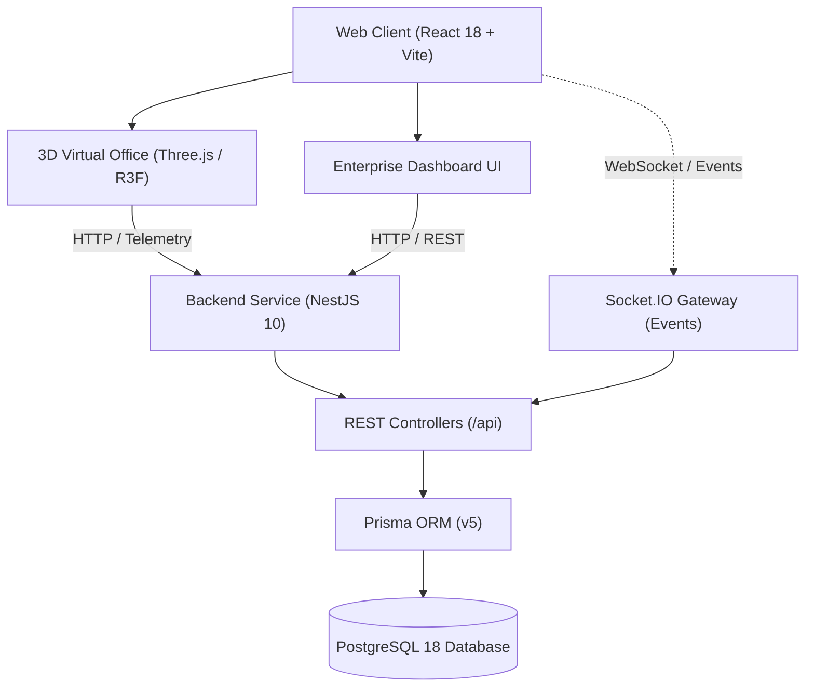

# System Architecture Overview

**Virtual AI Company (VAC)** is a high-performance enterprise platform engineered to host an autonomous workforce of AI employees collaborating in an interactive isometric 3D virtual office environment.

---

## High-Level Topology



---

## Monorepo Layout

The platform uses a unified `pnpm workspace` architecture separating application runtimes from reusable type contracts and validation rules:

```
virtual-ai-company/
├── apps/
│   ├── web/               # React 18, Vite, Three.js, R3F, TailwindCSS, Zustand
│   └── api/               # NestJS 10, Prisma ORM, Socket.IO, REST controllers
├── packages/
│   ├── shared/            # Common domain types, interfaces, department constants
│   └── validators/        # Zod runtime schema validators for data integrity
├── infrastructure/        # Dockerfiles, docker-compose, postgres initialization scripts
├── docs/                  # System, frontend, backend, and database architecture documentation
├── .env.example           # Canonical environment configuration template
├── docker-compose.yml     # Containerized PostgreSQL definition
├── package.json           # Monorepo root scripts & tooling
└── pnpm-workspace.yaml    # Workspace package glob declarations
```

---

## Core System Principles

1. **Strict Separation of Concerns**:
   - Backend logic encapsulates all database operations, migrations, and DTO validations.
   - Frontend is a reactive client utilizing Zustand stores for spatial and corporate state management.
   - Data contracts are strictly shared across packages via `@vac/shared` and `@vac/validators`.

2. **Database Integrity & Extensibility**:
   - PostgreSQL backed by Prisma ORM.
   - Relational cascading rules, unique composite keys, foreign keys, and performant indexes.
   - 100% prepared for 1-to-1 agent LLM configuration attachments in Sprint 2.

3. **Spatial 3D Virtual Headquarters**:
   - Built on WebGL via Three.js, `@react-three/fiber`, and `@react-three/drei`.
   - Default isometric projection with full 3-axis orbital interaction (pan, tilt, zoom).
   - Modular workstation slots outfitted with `CharacterAnchor` components ready to mount rigged GLB characters in upcoming sprints.

4. **Telemetry & Real-Time Ready**:
   - Centralized health checks monitoring API and database ping latency.
   - Socket.IO gateway initialized for real-time agent lifecycle and spatial state broadcasts.
