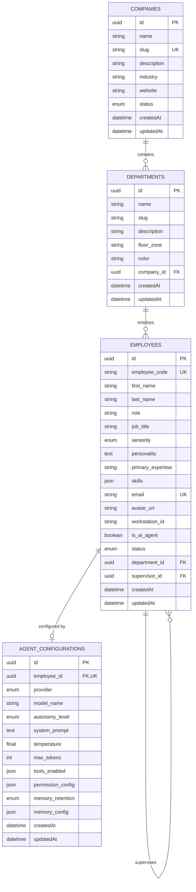

# Database Architecture & Entity-Relationship Design

The **Virtual AI Company (VAC)** database is built on **PostgreSQL** and managed using **Prisma ORM**.

---

## Entity-Relationship Diagram

---

## Database Schema Models

### 1. `Company` (Table: `companies`)
Represents an enterprise organization.
- `id` (UUID, Primary Key)
- `name` (String): Corporate entity name (editable).
- `slug` (String, Unique): URL/Routing slug (e.g., `nexus-ai-dynamics`).
- `description` (String, Optional): Corporate mission overview.
- `industry` (String, Optional): Industry categorization.
- `website` (String, Optional): Internal/external website URL.
- `status` (Enum: `ACTIVE`, `SUSPENDED`, `ARCHIVED`): Default `ACTIVE`.
- `createdAt` / `updatedAt`: Timestamps.

### 2. `Department` (Table: `departments`)
Represents a functional department / office zone within a company.
- `id` (UUID, Primary Key)
- `name` (String): Department name.
- `slug` (String): Department slug within company scope.
- `description` (String, Optional): Operational responsibility.
- `floorZone` (String, Optional): 3D spatial zone code (e.g., `ZONE_TECH`, `ZONE_ENG`).
- `color` (String, Optional): Hex color accent for UI badges and 3D floor markers.
- `companyId` (UUID, Foreign Key -> `companies.id`, with `ON DELETE CASCADE`).
- **Constraints**:
  - `@@unique([companyId, slug])`
  - `@@index([companyId])`

### 3. `Employee` (Table: `employees`)
Represents a human or synthetic AI employee in the organization.
- `id` (UUID, Primary Key)
- `employeeCode` (String, Optional, Unique): Corporate employee identifier (e.g. `VAC-TECH-001`).
- `firstName` / `lastName` (String): Personnel identification.
- `role` (String): Departmental role.
- `jobTitle` (String, Optional): Specific organizational job title.
- `seniority` (Enum: `INTERN`, `JUNIOR`, `MID`, `SENIOR`, `LEAD`, `PRINCIPAL`, `EXECUTIVE`): Default `MID`.
- `personality` (Text, Optional): Behavioral temperament and communication style.
- `primaryExpertise` (String, Optional): Core specialized domain.
- `skills` (JSON, Optional): Array or structured taxonomy of competencies.
- `email` (String, Unique): Work email address.
- `avatarUrl` (String, Optional): Avatar asset or GLB skin reference.
- `workstationId` (String, Optional): 3D workstation anchor mapping (e.g. `technology-1`, `engineering-3`).
- `isAiAgent` (Boolean): Defaults to `true`.
- `status` (Enum: `ACTIVE`, `IDLE`, `BUSY`, `OFFLINE`): Defaults to `ACTIVE`.
- `departmentId` (UUID, Foreign Key -> `departments.id`, with `ON DELETE CASCADE`).
- `supervisorId` (UUID, Optional Foreign Key -> `employees.id`, with `ON DELETE SET NULL`).
- **Constraints**:
  - `@@index([departmentId])`
  - `@@index([status])`
  - `@@index([supervisorId])`

### 4. `AgentConfiguration` (Table: `agent_configurations`)
Independent runtime parameters for synthetic AI employees.
- `id` (UUID, Primary Key)
- `employeeId` (UUID, Unique Foreign Key -> `employees.id`, with `ON DELETE CASCADE`).
- `provider` (Enum: `OLLAMA`, `OPENAI`, `ANTHROPIC`): Default `OLLAMA`.
- `modelName` (String): Model identifier (default: `qwen3.5:4b`).
- `autonomyLevel` (Enum: `MANUAL`, `SUPERVISED`, `AUTONOMOUS`): Default `SUPERVISED`.
- `systemPrompt` (Text, Optional): Agent behavioral prompt / system instructions.
- `temperature` (Float): Inference sampling temperature (default: `0.7`).
- `maxTokens` (Int): Context response limit (default: `2048`).
- `toolsEnabled` (JSON, Optional): List or object defining allowed tools/APIs.
- `permissionConfig` (JSON, Optional): Security and capability boundary permissions.
- `memoryRetention` (Enum: `SESSION`, `LONG_TERM`): Memory scope.
- `memoryConfig` (JSON, Optional): Vector memory and context window limits.

---

## Seed Data Specification

The database seed (`apps/api/prisma/seed.ts`) idempotently registers:
1. **Company**: `Nexus AI Dynamics` (`nexus-ai-dynamics`). Editable through platform settings.
2. **Departments (8)**:
   - Technology (`ZONE_TECH`, `#3b82f6`)
   - Engineering (`ZONE_ENG`, `#10b981`)
   - Research (`ZONE_RESEARCH`, `#8b5cf6`)
   - Business Analysis (`ZONE_BA`, `#f59e0b`)
   - Creative (`ZONE_CREATIVE`, `#ec4899`)
   - Operations (`ZONE_OPS`, `#06b6d4`)
   - Quality Assurance (`ZONE_QA`, `#ef4444`)
   - Administration (`ZONE_ADMIN`, `#6366f1`)
3. **Employees**: 0 seeded records (Zero fake executions or mock activity per Sprint 1 engineering requirements).
